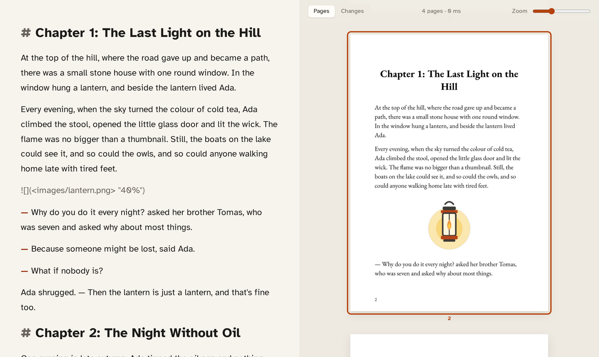
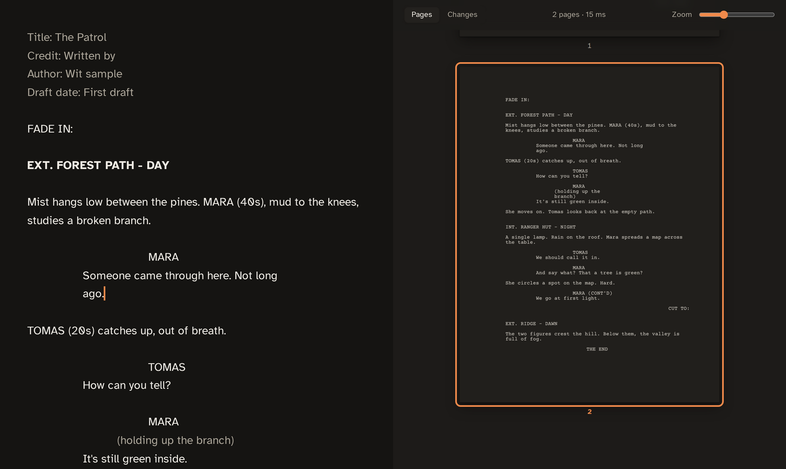

# Wit

A calm, local web editor for writing that ends up in print: books, essays,
screenplays and stage plays. You write plain text on the left (Markdown, or
Fountain for scripts) and see the real printed pages on the right. Typst lays out the pages and runs inside
the server, so pages update a few milliseconds after you stop typing.





## Run

```bash
./run.sh            # builds the web UI and server, then serves http://localhost:7700
```

From Windows (WSL2), open http://localhost:7700. You need Rust and Node. The
`typst` CLI is not needed.

The first time it runs, Wit opens two samples from `examples/`: a short
illustrated book and a screenplay. Open or create your own with Alt+O and
Alt+N.

Open documents are listed in `wit.json`, which is this computer's own list and
is not committed. Each book is a directory with `story.md`, `book.yaml` and
`images/`:

```json
{ "books": [{ "id": "my-novel", "dir": "../my-novel", "source": "story.md", "config": "book.yaml" }] }
```

Wit was called Quire. It moves the old `quire.json` to `wit.json` and each
book's `.quire/` folder to `.wit/` the first time it runs, and still reads
the old `QUIRE_*` variables.

Set `WIT_PORT` or `WIT_WORKSPACE` (a path to another `wit.json`) to run
a second copy, for example a test copy on port 7702.

Wit listens only on this machine (`127.0.0.1`), because the API can read and
change your books. From Windows, http://localhost:7700 still reaches it in WSL.
To use it from another device on your network, start it with
`WIT_HOST=0.0.0.0`, but only on a network you trust.

## Desktop app (Windows)

`desktop/` is a Tauri 2 shell. It runs the same server in-process on a random
`127.0.0.1` port and shows it in a native WebView2 window. Proof/Print PDF
links open in the default browser.

```bash
desktop/build-windows.sh   # cross-builds from WSL
```

It makes two things:

- `target/x86_64-pc-windows-gnu/release/bundle/nsis/Wit_<version>_x64-setup.exe`,
  an installer. It installs for the current user without admin rights and
  fetches WebView2 if Windows lacks it.
- `target/Wit/`, a folder to run without installing: `Wit.exe`,
  `WebView2Loader.dll`, `web/` and `fonts/`. Copy the whole folder; the exe
  needs the other three beside it.

The books are listed in `%APPDATA%\app.wit.desktop\wit.json` (or
`WIT_WORKSPACE`). Book folders can be Windows paths or WSL paths such as
`\\wsl.localhost\Ubuntu\home\...`.

The build needs NSIS (`sudo apt install nsis`) and uses MinGW if it is
installed (`sudo apt install mingw-w64`), otherwise cargo-zigbuild. Installers
for others come from the Windows workflow (Actions → Windows → Run workflow,
or a release tag), which builds on Windows. They aren't code-signed yet, so
SmartScreen warns the first time ("More info" → "Run anyway").

## Desktop app (Linux)

```bash
desktop/build-linux.sh     # AppImage, .deb and .rpm; works in WSL too
```

The output is in `target/release/bundle/`: `appimage/` (one file for any
distro), `deb/` (Ubuntu, Debian) and `rpm/` (Fedora, openSUSE). It needs the
WebKitGTK dev packages; the script lists them. The books are listed in
`~/.config/app.wit.desktop/wit.json` (or `WIT_WORKSPACE`).

Builds for others come from the Linux workflow (Actions → Linux → Run
workflow, or a release tag), which builds on Ubuntu 22.04 so the binaries run on
older distros too.

## Releases

Set `version` in `desktop/tauri.conf.json`, commit, then tag and push:

```bash
git tag v0.2.0 && git push origin v0.2.0
```

The Release workflow builds Windows, Linux and macOS and opens a draft GitHub
release with the Windows installer, AppImage, .deb, .rpm and .dmg attached.
Check it and press Publish.

## Documents

**New** (Alt+N) asks what you are writing and makes a folder named after the
title, next to the last one by default:

| Kind | Text file | Starts with |
|---|---|---|
| Book | `story.md` (Markdown) | EB Garamond, A5 |
| Essay | `essay.md` (Markdown) | Source Serif 4, 6 × 9 in, sections flow on |
| Screenplay | `script.fountain` | Courier Prime, US Letter, industry layout |
| Stage play | `play.fountain` | Courier Prime, US Letter, US manuscript layout |

`book.yaml` records the kind (`document_type`). **Open** (Alt+O) adds an
existing folder: one with any of those files, or a single `.md` or
`.fountain` file. Both add it to `wit.json`. The desktop app uses the
Windows folder dialog; in a browser you type the path.

### Scripts (Fountain)

[Fountain](https://fountain.io) is plain text that lays itself out as a script:

```fountain
Title: The Patrol
Author: Ana Pop

EXT. FOREST PATH - DAY

Tall trees, morning light. A young wolf, NORI, sniffs the air.

NORI
(whispering)
Do you hear that?

CUT TO:
```

A line starting `INT.` or `EXT.` is a scene heading; a line in capitals
followed by text is a character and their dialogue; `(…)` under a character is
a parenthetical; a capitals line ending in `TO:` is a transition. Force any of
them with `.`, `@`, `!` (action) or `>`. `> THE END <` is centred, `===` is a
page break, `[[notes]]` and `/* boneyard */` don't print, and `*italic*`,
`**bold**` and `_underline_` work as usual. In a stage play `# ACT ONE` and
`## Scene 1` are the act and scene headings. The editor indents each element
where it will print. The script commands (Ctrl+Shift+1 to 5, also on the dock)
make scene headings, characters, parentheticals, transitions and centred text.

Screenplays print in the standard layout: Courier Prime 12 pt, 1.5 in left
margin, characters at 3.7 in, dialogue at 2.5 in, page numbers top right from
page 2, about a minute of screen time per page. A4 keeps the same measures.
Not yet: `(MORE)` / `(CONT'D)` when a speech crosses a page, and dual dialogue
side by side (`^` is accepted and printed one after the other).

## Fonts and page setups

Wit ships ten open fonts (see `fonts/README.md`): EB Garamond, Crimson Pro,
Libre Baskerville, Literata, Lora, Alegreya, Source Serif 4, Andika, Atkinson
Hyperlegible and Courier Prime. Page setup also lists every font on the
computer. Fonts you may not share, like Cambria, go in `fonts/local/`, which
git ignores.

Page sizes cover KDP's whole paperback list (5 × 8 in up to 8.5 × 11 in),
IngramSpark's mass-market sizes, the UK formats (A, B, Demy, Royal), ISO A
and B sizes, the 13 × 20 cm Romanian paperback and square picture books.
Style presets set a whole look in one step: novels (6 × 9, digest, 5 × 8,
mass-market, UK B-format, Demy hardback, A5, 13 × 20), large print, non-fiction,
workbook, standard manuscript (Letter, A4), essays, children's books, picture
books, screenplays and stage plays. On KDP sizes the print checklist checks
KDP's rules: at least 24 pages, the spine-side margin for the page count,
outside margins and the 0.125 in bleed.

## Writing conventions

| Markdown | Result |
|---|---|
| `# Title` | Chapter (new page, per Page setup) |
| `## Title` | Section heading |
| blank line | New paragraph |
| `— ` at line start | Dialogue (Ctrl+D or typing `--` inserts it) |
| `**bold**`, `*italic*` | Bold, italic (Ctrl+B / Ctrl+I) |
| `<u>text</u>` | Underline (Ctrl+U) |
| `- item`, `1. item` | Bulleted or numbered list (Ctrl+Shift+8 / Ctrl+Shift+7) |
| `[words](https://…)` | Link (Ctrl+K); clickable in the PDF |
| `---` | Scene break (centred ***) |
| `> text` | Quoted block, italic |
| `` | Spot illustration, 70% of text width |
| `` | Spot illustration at that width |
| `` | Full-page illustration, to the edge (bleed) |
| `<!-- pagebreak -->` | Forced page break |

## Features

- **Auto-save** 0.8 s after you stop typing. If `story.md` changes on disk
  outside Wit, saving pauses and asks which version to keep. Unsaved text
  is also kept as a draft in the browser.
- **Page setup** edits `book.yaml` in place. It keeps comments and unknown
  keys, so `make_book.py` still works. It includes style presets (bedtime A5,
  booklets, early reader, picture book, novels) and a print checklist (page
  count a multiple of 4, image resolution at the size it's placed). Presets
  live in `src/settings.rs` (`style_presets`).
- **Proof PDF** follows `book.yaml`, including dark proofing pages. **Print
  PDF** always has white pages.
- **Dark page previews**: in the Dark and Dark OLED themes the preview pages
  are drawn dark too (a setting, on by default). Only the preview: both PDFs
  keep their real colours, and a book's own dark proofing pages still win.
- **Command palette** (Ctrl+Shift+P or F1), like VS Code: every action, with
  its shortcut, by typing part of its name. Recently used commands come first.
- **Toolbar** of thin icons (Open, New, Save, Write / Split / Page mode, Focus,
  Settings, Export, Print), hidden until Alt+5. The bottom corner stays empty
  unless saving has a problem; words and the revision are in the statistics sidebar.
- **Formatting dock** floating over the text (Ctrl+Space, or Alt+6): bold, italic,
  underline, dialogue, lists, illustration, link, text size.
- **Revisions** (Alt+H): the story file is the working draft and saves itself.
  Name a revision (Alt+Shift+S) to keep the draft as it is, for good. Until the
  next one, Wit keeps one copy per writing day, up to ten; naming a revision
  clears them. Going back to an older one first keeps the current draft as a
  revision.
- **Changes** (Alt+C): in Split mode the right pane can show, instead of the
  pages, the chapter you're in with everything changed since the latest named
  revision marked.
- **Export** (Alt+E): Print PDF, Proof PDF, or a Word (.docx) or OpenDocument
  (.odt) manuscript for an editor. The desktop app saves through a native
  dialog instead of opening a browser.
- **Focus mode** (Alt+4, Esc leaves): hides the toolbar and pages, dims
  every paragraph except the current one, and keeps the cursor line centred.
- **Sync**: click a page to jump to its text. Moving the cursor highlights its page.
- **Settings** (Ctrl+,): Light, Dark and Dark OLED (true black, dimmed text)
  themes; editor font (sans: Atkinson Hyperlegible, Inter, Source Sans 3;
  serif: Literata, Newsreader, Merriweather; mono: IBM Plex Mono, JetBrains
  Mono, Courier Prime); text size (Alt+= / Alt+-); lighter text, the Light weight of fonts that have
  one (Alt+9); spell check (Alt+8).

Every shortcut, for Windows, Linux and Mac, is in [docs/shortcuts.md](docs/shortcuts.md).
Ctrl+O, Ctrl+S and Ctrl+P work too, so the browser never opens, saves or
prints the editor page itself.

## Files

- `src/`: Rust server (axum). `engine.rs` is the in-process Typst world,
  `md.rs` converts Markdown to Typst, `settings.rs` covers page setup and presets.
- `template/book.typ`: the page design. It reads the settings from `book.yaml`.
- `web/`: the editor UI (Vite + CodeMirror). `npm run build` updates it with
  no server restart.
- `fonts/`: fonts preferred over system fonts (Cambria).
- In each book: `.wit/revisions/` holds named revisions (`v1.md`, `v2.md`…,
  names in `index.json`), kept for good; `.wit/daily/` holds up to ten daily
  copies of the working draft since the latest revision (`2026-10-12.md`).
  Preview pages are kept in memory, not on disk.
